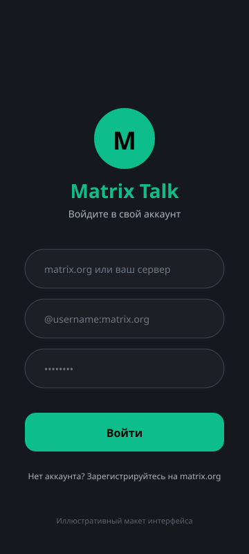
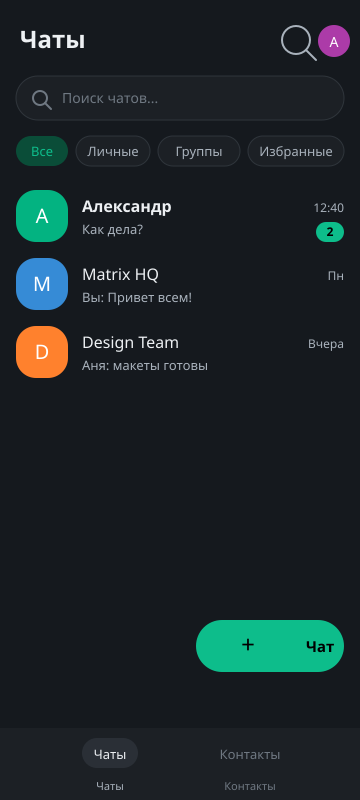
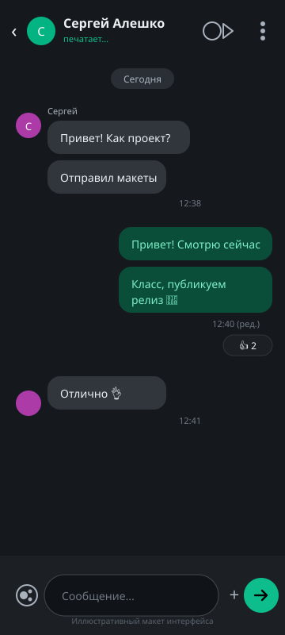

# MatrixTalk

Мультиплатформенный клиент для децентрализованной сети **Matrix**, написанный на **Kotlin Multiplatform** с общим UI на **Compose Multiplatform** в стиле **Element X**. Один код — Android и Desktop (Windows / Linux / macOS).

| Платформа | Статус |
|-----------|--------|
| 🤖 Android | ✅ Готово (подписанный APK в [релизах](https://github.com/sergej19882906/matrixtalk/releases)) |
| 🖥️ Windows / Linux / macOS | ✅ Готово (MSI / DEB / DMG / AppImage в [релизах](https://github.com/sergej19882906/matrixtalk/releases)) |
| 🍎 iOS | 🚧 В планах |

## Возможности

### 💬 Мессенджер
- ✅ Вход по логину/паролю и по Matrix access token, server discovery (.well-known)
- ✅ Список чатов в стиле Element X: фильтр-чипы (Все / Личные / Группы / Избранные / Непрочитанные), непрочитанные, «отметить как непрочитанную» (m.marked_unread, синхронно с Element), даты
- ✅ **Фильтр по пространствам** — чипы Spaces фильтруют ленту, долгое нажатие открывает каталог пространства
- ✅ Избранное, приглашения (принять/отклонить), каталог публичных комнат, контакты (поиск по user directory)
- ✅ Отправка текстовых сообщений, изображений, видео, аудио и файлов; **голосовые сообщения с волной** (запись, пауза, seek — MSC3245); **видеосообщения** (камера на Android, превью + play + длительность в ленте)
- ✅ **Системные события в ленте** — «присоединился/покинул», приглашения, исключения, смена названия/описания, room upgrade
- ✅ **Чип веток** под корневым сообщением («В ветке: N»), **поиск внутри чата**, завершение опросов, «поделиться matrix.to»
- ✅ **Геолокация** — отправка места (m.location): GPS на Android, ручной ввод на desktop; карточка с тайлом OpenStreetMap, клик открывает карту
- ✅ **Live-геолокация (MSC3488)** — трансляция своей геолокации 15 мин / 1 час / 8 часов (m.beacon_info + m.beacon), таймер и «Остановить» на карточке; просмотр чужих live-точек на всех платформах
- ✅ **Стикеры и стикер-паки** — типизированный m.sticker; паки MSC2545 (`im.ponies.*`, совместимо с Element/Cinny): глобальный пак, паки комнат, пикер с вкладками, добавление паков по ссылке (matrix.to / алиас / roomId) с автоприсоединением
- ✅ **Multi-select** — выбор нескольких сообщений: пакетное удаление и пересылка в другую комнату (медиа перешифровывается с сохранением MIME, опросы пересоздаются)
- ✅ **Панель «Файлы и медиа»** — все вложения комнаты с фильтрами «Медиа»/«Файлы» и бесконечной прокруткой
- ✅ **Редактор дерева Spaces** — порядок детей, suggested-флаг, привязка/отвязка комнат
- ✅ **Жалобы на сообщения** — отправка на сервер (spec report endpoint)
- ✅ Опросы (MSC3381, совместимые с Element): создание, голосование, результаты
- ✅ Ответы, упоминания с подсветкой, закреплённые сообщения, редактирование, удаление
- ✅ **Ветки (threads)** — полноценный экран ветки: корень закреплён, ответы, композер в m.thread
- ✅ **Slash-команды**: `/me`, `/join #alias`, `/leave`, `/invite`, `/kick`, `/ban`, `/unban`, `/help`
- ✅ **Markdown-композер** — жирный/курсив/код/зачёркнутый/списки/цитаты/ссылки уходят как org.matrix.custom.html
- ✅ **Реакции**: быстрые + палитра 48 эмодзи с поиском и «часто используемыми»; клик по своей реакции отзывает её
- ✅ **Read receipts** — аватары дочитавших под своими сообщениями
- ✅ **Presence** — статус «в сети» собеседника в шапке чата и точка на аватаре в списке (опрос раз в минуту)
- ✅ Fullscreen-просмотрщик изображений: листание медиа комнаты, зум до 5×, скачивание
- ✅ Загрузка истории («Загрузить ранее»), серверный поиск, переход к первому непрочитанному с разделителем
- ✅ Индикатор набора текста (typing)
- ✅ Персистентная сессия — автовход при перезапуске; персистентный кэш (Realm)
- ✅ Медиа через аутентифицированный клиент (MSC3916) — работает на matrix.org
- ✅ Material Design 3, тёмная/светлая/системная тема
- ✅ **Двухпанельный режим (Element Web)** — список чатов слева, открытый чат справа, адаптив по ширине окна
- ✅ **Цветовые палитры из element-themes** — Nord, Dracula, Catppuccin, Gruvbox, Solarized, Monokai Pro, Everforest (тёмная и светлая версии каждой), выбор в настройках

### 🔐 Безопасность
- ✅ E2E-шифрование (libolm), просмотр зашифрованных вложений
- ✅ **E2EE-медиа на отправку** — фото/видео/файлы/голосовые/стикеры в зашифрованных комнатах уходят как EncryptedFile (AES-CTR-256 + SHA-256, совместимо с Element); весь custom-контент (файлы, стикеры, опросы, геолокация) отправляется через fail-closed sender: в зашифрованной комнате событие сначала шифруется, иначе отправка не выполняется
- ✅ Управление устройствами: список сессий, переименование, удаление, «последняя активность»
- ✅ Верификация устройств по эмодзи (SAS) и самоверификация сессии ключом восстановления — как в Element
- ✅ Статус резервного копирования ключей (megolm backup) в настройках
- ✅ Подтверждение паролем (UIA) для чувствительных операций
- ✅ **App lock** — PIN-блокировка приложения: salted PBKDF2 (без обратимой записи PIN), смена/отключение с проверкой текущего PIN, задержка после неудачных попыток, повторная блокировка при уходе в фон
- ✅ **Обработка отозванной сессии** — при M_UNKNOWN_TOKEN автоматический выход на экран входа с пояснением; фоновые воркеры останавливаются
- ✅ **Деактивация аккаунта** — необратимое удаление через сервер (UIA по паролю, опция «стереть сообщения»), двойное подтверждение в настройках
- ✅ **Заблокировать пользователя** — игнор-лист (m.ignored_user_list): сообщения блокированного скрываются во всех комнатах
- ✅ **Жалобы** — на сообщения и на пользователей целиком (spec report endpoints)
- ✅ **Смена пароля** и управление **email/телефоном (3PID)** в настройках аккаунта
- ✅ Информативное **имя сессии в Element** («MatrixTalk · Android · …»), авто-заполнение если пусто

### ⚙️ Настройки комнаты (Element X)
- ✅ Редактирование названия/описания/аватара **по power levels** — без прав поля не редактируются
- ✅ Список участников с поиском и бейджами прав (Админ ≥100, Модератор ≥50)
- ✅ Карточка участника: **исключить, бан/разбан, сменить уровень прав**
- ✅ Приглашение пользователей
- ✅ **Уровни уведомлений per-room** — «Все сообщения» / «Только упоминания» / «Без звука» через серверные push-правила (как в Element Web)
- ✅ Бейдж моста на комнатах-мостах (m.bridge, MSC2346)

### 🔔 Уведомления
- ✅ **Мгновенный push через UnifiedPush** (ntfy, NextPush и другие дистрибьюторы) — без Google-сервисов; устройство регистрируется на homeserver как HTTP-pusher (named-аргументы API, exported receiver по контракту UnifiedPush)
- ✅ Фолбэк: фоновая проверка WorkManager раз в 15 минут — работает вообще без дистрибьютора
- ✅ **Уровень по умолчанию для новых комнат** (Все / Упоминания) — применяется автоматически при входе
- ✅ Уведомления о новых сообщениях и звонках, Boot-receiver для восстановления фона
- ✅ Фоновый воркер соблюдает настройки приложения: тумблер уведомлений, per-room mute, режим «только упоминания», дедупликация — до показа уведомления

### 🌐 Сеть
- ✅ **Прокси** — HTTP / SOCKS5 с авторизацией; весь трафик (чаты, медиа, фон, discovery) через прокси

### 📞 Аудио-видео звонки (VoIP)
- ✅ Сигналинг Matrix (m.call.*, VoIP v0 + party_id для совместимости с Element), работает в E2EE-комнатах
- ✅ WebRTC-медиа на Android (stream-webrtc-android) и Desktop (webrtc-java): аудио + видео, TURN/STUN с homeserver
- ✅ Входящие/исходящие звонки, экран звонка с микрофоном/камерой/динамиком, foreground-сервис на Android
- ✅ Демонстрация экрана на Desktop, выбор камеры/микрофона в настройках
- ✅ Звонки из комнат с выключенными уведомлениями автоматически отклоняются
- ✅ Серверная часть: Coturn (TURN/STUN) включён в Docker-стек

### 🔗 Мосты (12 сетей)
- ✅ Справочник мостов в приложении с инструкциями и готовыми Docker-образами
- ✅ **Живое детектирование**: секция «Запущенные мосты» показывает, какие сети реально работают в аккаунте, комнаты-мосты помечаются в списке чатов
- ✅ Серверная часть: Synapse + PostgreSQL + Coturn + 8 мостов в Docker
- ✅ Полная инструкция по установке сервера в [`docs/bridges.md`](docs/bridges.md)

## Сервер

`docker-compose.bridges.yml` — готовый стек для собственного Matrix-сервера.
Кастомные Docker-образы с авто-конфигурацией из env-переменных публикуются в [ghcr.io](https://github.com/sergej19882906/matrixtalk/pkgs/container/) (`linux/amd64` + `linux/arm64`).

| Сервис | Образ | Назначение |
|--------|-------|------------|
| **Synapse** | `ghcr.io/sergej19882906/matrixtalk-synapse` | Matrix homeserver |
| **synapse-admin** | `awesometechnologies/synapse-admin` | Веб-админка (порт 8080) |
| **PostgreSQL** | `postgres:16-alpine` | База данных |
| **Coturn** | `coturn/coturn:latest` | TURN/STUN для VoIP |
| **mautrix-telegram** | `ghcr.io/sergej19882906/matrixtalk-mautrix-telegram` | Мост Telegram |
| **mautrix-whatsapp** | `ghcr.io/sergej19882906/matrixtalk-mautrix-whatsapp` | Мост WhatsApp |
| **mautrix-signal** | `ghcr.io/sergej19882906/matrixtalk-mautrix-signal` | Мост Signal |
| **mautrix-meta** | `ghcr.io/sergej19882906/matrixtalk-mautrix-meta` | Мост Facebook/Instagram |
| **mautrix-gmessages** | `ghcr.io/sergej19882906/matrixtalk-mautrix-gmessages` | Мост Google Messages (SMS/RCS) |
| **mautrix-discord** | `ghcr.io/sergej19882906/matrixtalk-mautrix-discord` | Мост Discord |
| **heisenbridge** | `ghcr.io/sergej19882906/matrixtalk-heisenbridge` | Мост IRC |
| **hookshot** | `ghcr.io/sergej19882906/matrixtalk-hookshot` | GitHub/GitLab/Jira/webhooks |

Пошаговая инструкция по установке и настройке — в [`docs/bridges.md`](docs/bridges.md).

## Скриншоты интерфейса

Иллюстративные макеты интерфейса (тёмная тема):

<p>
  
  
  
</p>

## Технологии

| Компонент | Технология |
|-----------|-----------|
| **Язык** | Kotlin Multiplatform (2.0.21) |
| **UI** | Compose Multiplatform + Material 3 (стиль Element X) |
| **Архитектура** | MVVM + Clean Architecture, общий модуль `shared` |
| **DI** | Koin 4 |
| **Matrix SDK** | [Trixnity](https://github.com/trixnity/trixnity) 4.9.2 |
| **E2E-шифрование** | libolm (trixnity-olm) + шифрование медиа (AES-CTR-256) |
| **Сеть** | Ktor client 3 |
| **Изображения** | Coil 3 (KMP), медиа через аутентифицированный клиент (MSC3916) |
| **Push** | UnifiedPush (connector 2.4) + WorkManager-фолбэк |
| **Сессия/кэш** | JSON-файл сессии + Realm (trixnity-client-repository-realm) |
| **Сборка** | Gradle KMP: Android + Desktop(JVM); iOS в планах |

## Структура проекта

<pre>
├── shared/                     # Общий KMP-модуль
│   └── src/
│       ├── commonMain/         # Всё общее: модели, репозитории, ViewModel'и, UI, DI
│       ├── androidMain/        # Android-actuals (контекст, файлы, push-воркеры, GPS)
│       └── desktopMain/        # Desktop-actuals (JVM)
├── app/                        # Android-приложение (Activities, сервисы, push-приёмник)
├── desktop-app/                # Desktop-приложение (Compose Window, точка входа JVM)
├── docker/                     # Кастомные образы Synapse + 8 мостов
├── docs/                       # Инструкция по серверу, скриншоты
└── server-data/                # Данные сервера (gitignored)
</pre>

## Сборка и запуск

### Требования
- JDK 21 для Gradle и desktop-упаковки (Android/JVM-код компилируется для Java 17)
- Python 3 для проверок релизных метаданных; на Windows команда `python`, на Linux/macOS — `python3`. При необходимости задайте полный путь переменной `PYTHON`.
- Android Studio Ladybug (2024.2.1) или новее — для Android
- Android SDK 36 — для Android

### Android
Откройте проект в Android Studio и запустите на эмуляторе/устройстве, либо:

```bash
# Windows
.\gradlew.bat :app:assembleDebug

# Linux/macOS
chmod +x gradlew
./gradlew :app:assembleDebug
```

### Desktop (Windows / Linux / macOS)

```bash
./gradlew :desktop-app:run          # запуск из исходников

# инсталляторы:
./gradlew :desktop-app:packageMsi   # Windows (.msi)
./gradlew :desktop-app:packageDeb   # Linux (.deb)
./gradlew :desktop-app:packageDmg   # macOS (.dmg)
```

Для подписанного release APK поместите keystore в корень проекта и укажите параметры в `local.properties` (см. раздел CI/CD ниже — в релизах APK уже подписан).

### Мгновенный push на Android
Установите любой UnifiedPush-дистрибьютор — например [ntfy](https://ntfy.sh) (F-Droid/Play). При следующем запуске MatrixTalk зарегистрируется, и в настройках появится статус «Мгновенный push через UnifiedPush». Synapse ничего дополнительно не требует — он шлёт push прямо в эндпоинт дистрибьютора.

Полностью self-hosted вариант: в Docker-стек входит сервер ntfy (`docker compose ... up -d ntfy`) — тогда и доставка push идёт через ваш домен. Инструкция — в [`docs/bridges.md`](docs/bridges.md), шаг 6.

## CI/CD

GitHub Actions:

- **CI** (push/PR в `main`) — проверка релизных метаданных и workflow, сборка Android APK, компиляция Desktop и юнит-тесты, валидация docker-compose.
- **Release** (тег `vX.Y.Z` или ручной запуск с существующим тегом) — проверка «тег = версия», Android APK + MSI/DEB/DMG со smoke-тестами и сверкой метаданных. Публикация [GitHub Release](https://github.com/sergej19882906/matrixtalk/releases) только при полном наборе четырёх пакетов; незавершённый черновик можно продолжить повторным запуском. Уже опубликованные пакеты автоматически не заменяются.
- **macOS** — поддерживаемый Intel-раннер `macos-15-intel`. Если сертификаты настроены, подпись выполняется штатным механизмом Compose **до упаковки**, затем проверяются содержимое DMG, notarization и stapling.
- **Linux AppImage** — отдельная сборка после публикации основного релиза. Её успех проверяется отдельно; наличие APK/MSI/DEB/DMG не означает, что AppImage готов.
- **Docker** (push в `main`, теги) — сборка и пуш образов сервера и мостов в ghcr.io (`linux/amd64` + `linux/arm64`).

Секреты подписи:
- Android: `KEYSTORE_BASE64`, `KEYSTORE_ALIAS`, `KEYSTORE_PASSWORD`, `KEY_PASSWORD`. Если ни один секрет не настроен, строится явно помеченный debug APK (подписан debug-ключом, не release-ключом); частичный набор — ошибка.
- Windows MSI (Authenticode): `WIN_PFX_BASE64`, `WIN_PFX_PASSWORD`. Без обоих секретов пакет неподписанный; частичный набор — ошибка.
- macOS DMG (codesign + нотаризация): `MAC_CERTIFICATE_BASE64`, `MAC_CERTIFICATE_PASSWORD`, `APPLE_ID`, `APPLE_TEAM_ID`, `APPLE_APP_SPECIFIC_PASSWORD`. Без сертификатов пакет неподписанный; если настройка начата, требуется полный набор. Секреты в журналы не выводятся.

### Выпуск версии

Единый источник версии — корневой `gradle.properties`:

```properties
releaseVersion=1.43.0
androidVersionCode=64
```

Android `versionName`, Desktop `packageVersion` и встроенная версия для «О приложении» берутся из `releaseVersion`; `versionCode` должен увеличиваться при каждом Android-релизе. Не редактируйте номера в нескольких Gradle-файлах.

Добавьте точный заголовок `## 1.43.0` в `RELEASE_NOTES.md`, обновите README и проверьте изменения перед коммитом/публикацией:

```bash
python -I -m unittest discover -s scripts -p 'test_*.py'
./gradlew verifyReleaseMetadata -PreleaseTag=v1.43.0
# После проверки и коммита:
git tag -a v1.43.0 -m "MatrixTalk 1.43.0"
git push origin v1.43.0
```

В исходных тегах v1.40.0–v1.42.0 ошибочно остались метаданные **1.39.0 / versionCode 59**, а публикация ожидала отключённый `macos-13`. Исправления опубликованы как **v1.42.1 / 63**; старые теги не перемещаются. Для восстановления старой версии ручной Release принимает `tag` и `source_ref`: исходники — отдельный потомок исходного тега с исправленной сборкой и номером этой версии. Точный SHA записывается в release notes; AppImage использует тот же SHA. Фактическую публикацию и содержимое пакетов проверяйте в GitHub Releases, а не только по имени тега.

## История версий

См. [`RELEASE_NOTES.md`](RELEASE_NOTES.md).

## Лицензия

См. [`LICENSE`](LICENSE).
